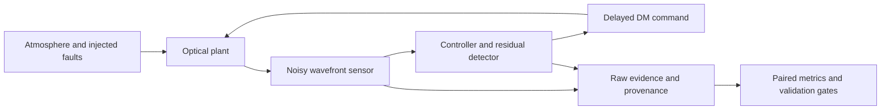

# noether-ao

**Differentiable adaptive optics. Reproducible control experiments.**

Noether AO is a research framework for designing and evaluating optical control
systems before instrument integration. It combines differentiable propagation,
noisy wavefront sensing, delayed control and fault injection in one reproducible
experimental pipeline.

The product objective is to make observatory control changes testable: compare a
candidate with a tuned baseline, inspect why it fails, and carry the same evidence
into hardware qualification. Today, the repository provides simulation, benchmarks
and an auditable study framework. Hardware integration is on the roadmap.

[Quickstart](#quickstart) · [Results](#measured-evidence) ·
[Architecture](docs/architecture.md) · [Documentation](docs/README.md) ·
[Roadmap](ROADMAP.md) · [Contributing](CONTRIBUTING.md)

## Why this exists

A fast optical model is useful only if it improves a feedback loop. That requires
accounting for sensor noise, command delay, compute cost and model mismatch.
A fault detector must also be judged by what its recovery action does to the
wavefront. Detection alone is insufficient.

This project makes those tradeoffs explicit:

- **Differentiable physics:** dLux/JAX propagation, frozen-flow turbulence, a modal
  deformable mirror and an ideal pyramid wavefront sensor.
- **Comparable controllers:** integrator, temporal predictor, forward-model
  estimation, and fixed or learned mixtures in the same delayed plant.
- **Inspectable experiments:** paired trials, saved observations and commands,
  source/runtime identities, deterministic selection and resumable evidence.

## Quickstart

Use Python 3.11 and uv. Access currently requires an authorized GitHub account.

```sh
git clone https://github.com/noetherlabs/noether-ao.git
cd noether-ao
uv sync --frozen --python 3.11
CI=true JAX_PLATFORMS=cpu .venv/bin/python -m pytest -q
```

For a first physical validation run, use the reduced functional configuration:

```sh
.venv/bin/noether-optics validate --config configs/reproduction_smoke.yaml --out runs/first-validation
```

Use a new output directory for each run. Inspect `gates.json` for the physical
checks, `table.md` for controller metrics, and `result.png` for the comparison.
This reduced functional run does not reproduce the full scientific claim tables.
See the [reproduction guide](docs/reproduction.md) for complete experiments,
optional Dragrace dependencies, saved-table reconstruction and timing precautions.

## System



The [architecture guide](docs/architecture.md) maps each layer to its implementation
and states the model assumptions. Software tests, independent physical agreement
and controller performance are assessed separately.

## Measured evidence

The completed v0 experiments test propagation latency (C1), model fidelity under
photon noise (C2), learned controller mixtures (C3), and detection with fallback
(C4). These verdicts are generated from retained runs, including negative results.

<!-- BEGIN HEADLINES -->

| Claim | Measured verdict |
| --- | --- |
| C1 | Conditional support. N=32, one wavelength, float32: p99 0.0592937 ms; N=256, five wavelengths: p99 6.38013 ms. CPU component only. |
| C2 | No tested flux gave useful equivalence across all fidelity levels. No supported low-flux threshold was found; lower fidelity often performed better under this fixed estimator. |
| C3 | Learned weights beat both integrator and forward in 0/12 conditions and lose to at least one in 5/12; remaining comparisons include uncertainty. |
| C4 | Partial detection/recovery, no general safety result. Optical-gain drift missed; vibration fallback worsened WFE; clean false alarms occurred. |

<!-- END HEADLINES -->

The [results report](docs/results.md) provides definitions, paired intervals, raw
data and limits. The timing figures describe CPU propagation components on an
Apple M1; they do not establish a full control-loop deadline.

A read-only [optical-gain observability audit](results/optical_gain_observability_audit_v1/README.md)
reclassifies the old M4 cohort as P2 development evidence. It selects a four-frame
lower-tail score with eight-window persistence, then the frozen
[P2 protocol](docs/optical_gain_observability_v1.md) assigns fresh, disjoint training,
validation and sealed evaluation streams. No P2 threshold or outcome has been
generated; the candidate is not validated and cannot act on the controller.

Independent validation adds:

- **Ideal-pyramid agreement:** [36 intensity cases, 30 derivative cases and 24
  deliberate-error controls](results/pyramid_validation_v1/report.md) against an
  HCIPy matrix-integral reference under matched finite-grid conventions.
- **Controller component checks:** [nine declared gates](results/controller_physics_smoke_v1/README.md)
  pass on a reduced plant with retained raw outputs. The network is untrained in
  this smoke run; the result verifies component wiring.
- **End-to-end execution smoke:** [nine runner gates](results/controller_runner_smoke_v1/README.md)
  pass through the production training, validation, selection and evaluation
  commands. The run stops after one held-out record and makes no performance claim.

## What works today

| Capability | State |
| --- | --- |
| Baseline experiments and report reconstruction | Implemented; retained runs and independent physical checks |
| Durable pilot acquisition and predictor fitting | Implemented; complete measured cohorts, saved coefficients and failed outcomes |
| Learned fitting and interrupted-run recovery | Implemented; common initialization, fixed Adam budget and saved episode gradients |
| Training coordination and aggregate freeze | Implemented; bounded `study-train` command, terminal-failure retention and all-model evidence binding |
| Validation command | Implemented; positive provenance-bound `study-validate` chunks; physics starts only after ledger checks |
| Selection command | Implemented; resume-only `study-select` audits complete validation and freezes chosen or withheld controllers |
| Evaluation command | Implemented; positive `study-evaluate` chunks enter held-out physics only after frozen-selection checks |
| Whole-run storage preflight | Implemented; 42.167 GB numeric payload, 105.033 GB conservative free-space requirement, zero compression credit |
| End-to-end runner smoke | Passed from committed source; 12 pilots, 2 fitted models, 100 validation records and 1 held-out record retained |
| Optical-gain observability protocol | Frozen, hash-bound and unexecuted; implementation and nonreserved runner smoke pending |
| Study ledger and trial execution | Implemented; immutable evidence and bounded validation/evaluation chunks |
| Complete new controller comparison | Pending; adequate study storage, reserved-cohort execution and final report |
| Instrument deployment | Planned; no hardware or on-sky result |

The [next study](docs/controller_study_v1.md) predeclares equal candidate budgets,
separate stochastic cohorts and simultaneous paired uncertainty. Reserved outcomes
have not been acquired. The [execution contract](docs/controller_study_execution.md)
tracks component boundaries and the complete four-stage command surface. A static
preflight now derives the full evidence budget without importing JAX or accessing a
cohort:

```sh
.venv/bin/noether-optics study-resources \
  --config configs/controller_study_v1.yaml \
  --target runs/controller-study-v1
```

It budgets 42,166,977,776 bytes of numeric payload, 94,996,396,512 bytes for retained
evidence, and 105,033,365,984 required free bytes after temporary-write headroom and
operating reserve. Compression receives no credit. The command prints auditable JSON,
creates no directory and returns status 2 when capacity is insufficient. The reserved
study's `study-train --create` path enforces the same budget and has no bypass flag.
The separate full-runner smoke has passed from committed source. The reserved study
remains blocked until a target filesystem satisfies this preflight. The
[roadmap](ROADMAP.md) defines the next deliverables and deployment gates.
[Correctness CI](https://github.com/noetherlabs/noether-ao/actions/workflows/correctness.yml)
runs without acquiring benchmark timings.

## Repository layout

| Path | Contents |
| --- | --- |
| `src/noether_optics/` | Python implementation and experiment entry points |
| `configs/`, `plans/` | Explicit physical settings, frozen protocols and trial plans |
| `tests/` | Numerical, physical, integrity and recovery checks |
| `results/` | Retained measurements, arrays, reports and provenance |
| `scripts/` | Reproduction, verification and reporting tools |
| `docs/` | Methods, architecture, execution contracts and development history |
| `contributions/` | Reconstructable Dragrace patch and unsubmitted drafts |

The GitHub repository and a fresh clone are named **noether-ao**. The Python
package `noether_optics` and CLI `noether-optics` retain their original names to
keep recorded environments and reproduction commands compatible. There is no
additional `noether-optics/` wrapper directory inside the repository.

## Development and availability

Developed by Noether Labs. See [Contributing](CONTRIBUTING.md) for setup, validation
and evidence standards, and the [changelog](CHANGELOG.md) for implemented changes.

The repository is currently private and has no open-source license. A dated
[release-readiness audit](docs/release_readiness.md) found no credential or retained
array-format blocker and verified a deterministic wheel, but publication still
requires owner decisions on licensing, history, provenance paths, distribution and
support. The [release checklist](ROADMAP.md#public-release) tracks those gates; the
current documentation does not confer reuse rights.
