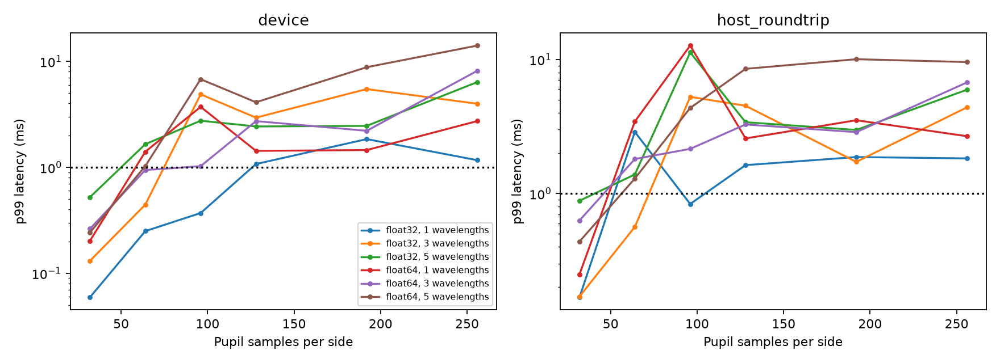
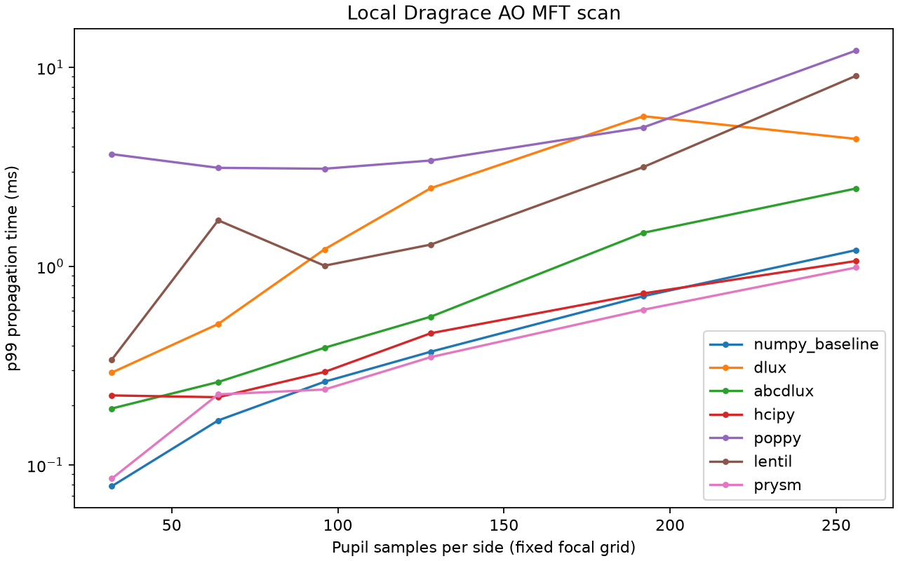
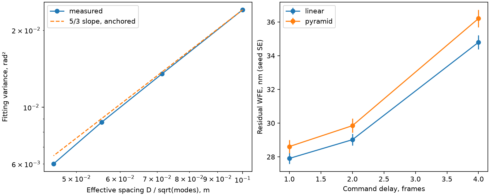
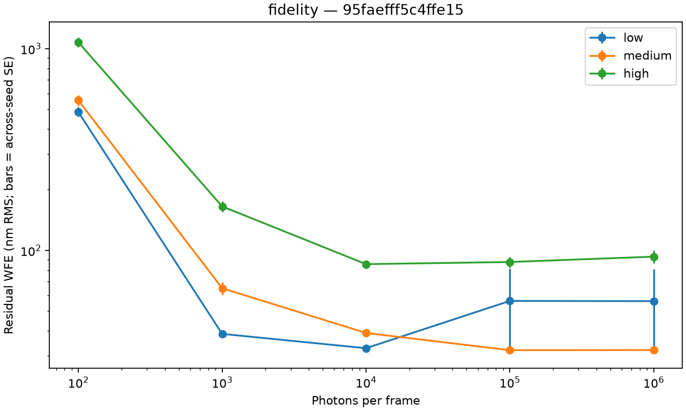
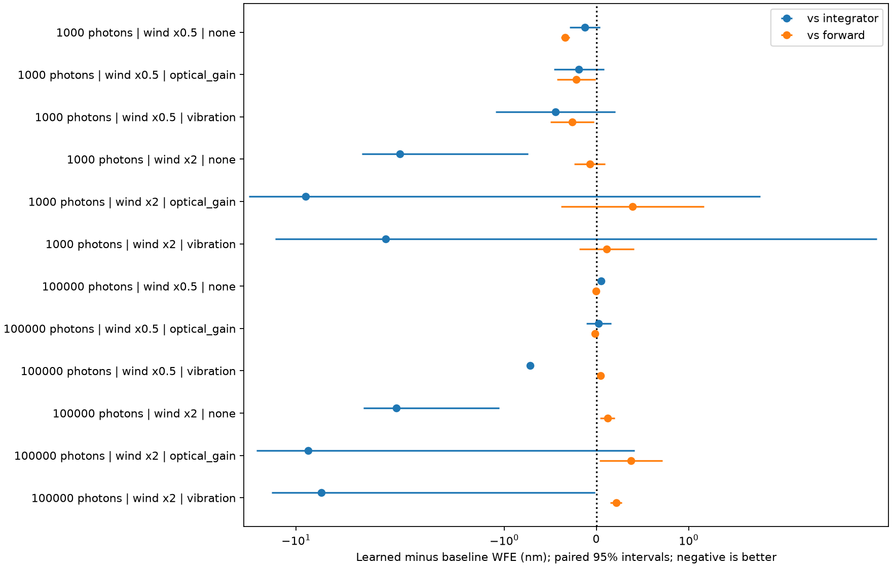
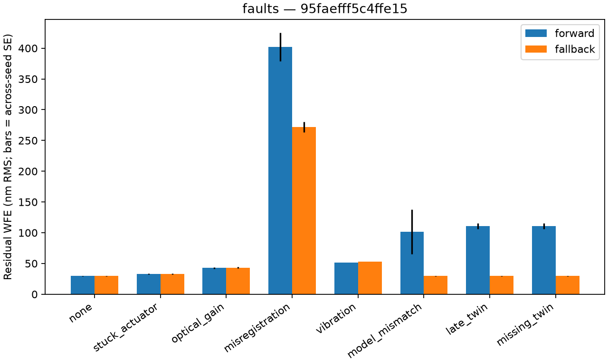
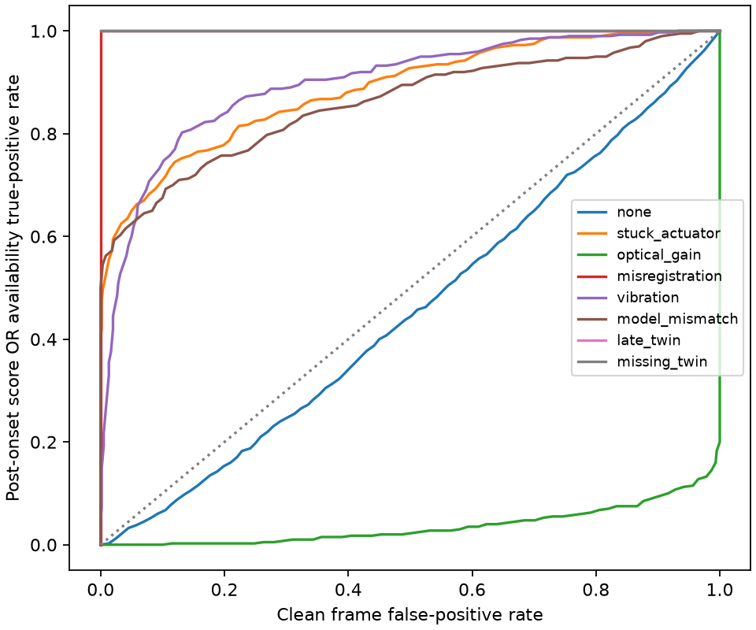

# Results and claim boundaries

All measurements below come from the versioned runs in this repository. Each
linked result directory holds raw data, configuration, machine fingerprint and
source provenance. Configuration values and declared tolerances are inputs,
not observations. No performance number is imported from another study.

<!-- BEGIN HEADLINES -->

| Claim | Measured verdict |
| --- | --- |
| C1 | Conditional support. N=32, one wavelength, float32: p99 0.0592937 ms; N=256, five wavelengths: p99 6.38013 ms. CPU component only. |
| C2 | No tested flux gave useful equivalence across all fidelity levels. No supported low-flux threshold was found; lower fidelity often performed better under this fixed estimator. |
| C3 | Learned weights beat both integrator and forward in 0/12 conditions and lose to at least one in 5/12; remaining comparisons include uncertainty. |
| C4 | Partial detection/recovery, no general safety result. Optical-gain drift missed; vibration fallback worsened WFE; clean false alarms occurred. |

<!-- END HEADLINES -->

## C1: single-plane propagation latency

The measured contract is a unit-power circular pupil with dynamic OPD, propagated
to separate wavelength-dependent focal grids. dLux and plain JAX return complete
complex fields. Every timed evaluation synchronizes before stopping the clock.
Compilation is separate; the host path forces input and output copies. This is
not a broadband summed PSF or a complete control iteration.

<!-- BEGIN LATENCY -->

144 engine/path/shape rows contain 1,440,000 synchronized evaluations. Maximum complex-field relative L2 error was 0. Selected dLux CPU rows follow; all use float32.

| N | Wavelengths | Path | p50 ms | p99 ms | Maximum ms | Miss >1 ms, fraction |
| --- | --- | --- | --- | --- | --- | --- |
| 32 | 1 | device | 0.032833 | 0.0592937 | 0.198833 | 0 |
| 64 | 1 | device | 0.070333 | 0.249896 | 3.29058 | 0.0007 |
| 96 | 1 | device | 0.139417 | 0.37017 | 1.47492 | 0.0006 |
| 128 | 1 | device | 0.318209 | 1.07354 | 7.07038 | 0.0128 |
| 192 | 1 | device | 0.37523 | 1.84554 | 15.6321 | 0.055 |
| 256 | 1 | device | 0.522375 | 1.16638 | 17.0522 | 0.0202 |
| 256 | 5 | device | 2.76012 | 6.38013 | 80.4132 | 1 |
| 32 | 1 | host_roundtrip | 0.089084 | 0.167883 | 3.57458 | 0.0003 |

Fingerprint: `d371bbeef075c20c`.

<!-- END LATENCY -->

The [full table](../results/m1/table.md) includes both precisions, all wavelengths,
both engines and both paths, with compile time, p90, p99.9, maxima and misses.
[Raw data and provenance](../results/m1/) retain the interrupted run and verified
continuation. GPU and enforced single-core modes were unavailable and skipped.
Observed maxima and misses matter: a low median is not a deadline guarantee.

The separate [Dragrace table](../results/m2/table.md) uses the existing fixed-grid
MFT contract. Its timings cannot be substituted for the FFT measurements above.
Seven adapters passed accuracy at every scan size. PROPER installed but reports
unsupported MFT. The [local patch](../contributions/dragrace.patch) adds only the
case, tail report columns, tests and supporting documentation.

## Physical validation before control claims

<!-- BEGIN PHYSICS -->

Both independent PSF checks passed; maximum normalized intensity relative L2 was 4.57108e-15. The fitting spacing exponent was 1.75315; the r0 exponent was -1.66667. All saved physical gates passed.

| Sensor | Integrator nm | Predictive nm | WFE reduction % | Predictive − integrator nm | Paired 95% interval nm |
| --- | --- | --- | --- | --- | --- |
| linear | 29.0179 | 21.713 | 25.1737 | -7.30488 | [-8.16621, -6.44355] |
| pyramid | 29.8495 | 21.9774 | 26.3727 | -7.87212 | [-8.95089, -6.79335] |

The nominal runs use 100 modes, 1000 Hz, 2 frames of delay, 160 frames per trial and 40 burn-in frames, with 5 evaluation seeds. These are configuration inputs.

<!-- END PHYSICS -->

The [gate results](../results/m3/gates.json), [PSF comparison](../results/m3/psf.md),
[delay table](../results/m3/delay.md) and [controller table](../results/m3/table.md)
are separate from software tests. The predictive improvement is a new measurement
in the configured regime, not an exact reproduction of an unspecified prior run.

## C2: fidelity versus photons

All fidelities observe the same higher-resolution plant through a common detector.
The fidelity levels jointly change sampling, wavelength quadrature and retained
modes. This experiment does not isolate the contribution of each change.
The largest model is not an oracle: its fixed-step estimator can perform worse.
The measured differences therefore combine optical fidelity, retained modes and
estimator conditioning. The results do not establish a photon-noise-only mechanism.
Equivalence requires a paired interval wholly within the predeclared fraction of
the high-fidelity mean, with both compared controllers unsaturated and better
than open loop for every seed. Failure to detect a difference is not equivalence.

<!-- BEGIN FIDELITY -->

No tested flux gave useful equivalence across all fidelity levels. No supported low-flux threshold was found; lower fidelity often performed better under this fixed estimator.

| Level | Pupil N | Wavelengths | Modes |
| --- | --- | --- | --- |
| low | 32 | 1 | 100 |
| medium | 64 | 3 | 150 |
| high | 96 | 5 | 200 |

| Photons/frame | Low WFE nm ± SE | Medium WFE nm ± SE | High WFE nm ± SE | All useful/equivalent |
| --- | --- | --- | --- | --- |
| 100 | 485.857 ± 26.7996 | 555.369 ± 33.898 | 1077.47 ± 56.3337 | False |
| 1000 | 38.5885 ± 0.654911 | 64.9805 ± 4.62295 | 165.328 ± 9.7974 | False |
| 10000 | 32.7653 ± 0.904634 | 38.9964 ± 1.35818 | 85.5462 ± 4.06766 | False |
| 100000 | 56.1995 ± 24.8496 | 32.0433 ± 0.811158 | 87.652 ± 5.49761 | False |
| 1e+06 | 56.0818 ± 24.7914 | 32.095 ± 0.913449 | 93.1656 ± 6.76496 | False |

Equivalence margin: ±5% of the high-fidelity mean (declared input); 5 paired seeds per cell. The disk interruption preserved the completed trials and recovered missing trials using verified original source. See `results/m5/interruption.json` and `recovery_complete.json`.

<!-- END FIDELITY -->

The [full fidelity table](../results/m5/table.md) gives every seed-mean, standard
error, paired difference, interval and equivalence decision. The [component-cost
table](../results/m5/component_latency.md) links each level to the matching M1
float64 CPU FFT result and raw timing file. These are component costs only.

## C3: learned forward/inverse weights

The fixed rule blends candidate commands using per-mode signal-to-noise and
residual size. A small shared network learns per-mode weights through a short
delayed loop. Training seeds are disjoint from evaluation seeds. Training uses a
Gaussian shot/read surrogate; evaluation uses exact Poisson counts and Gaussian
read noise. Training has no injected faults; fault evaluations are held out.
Some flux/wind combinations are also absent from training.

<!-- BEGIN MIXED -->

Learned weights beat both integrator and forward in 0/12 conditions and lose to at least one in 5/12; remaining comparisons include uncertainty.

| Mixture | Compared with | Wins | Loses | Inside noise |
| --- | --- | --- | --- | --- |
| fixed | integrator | 6 | 1 | 5 |
| fixed | forward | 2 | 2 | 8 |
| fixed | predictive | 4 | 2 | 6 |
| learned | integrator | 4 | 1 | 7 |
| learned | forward | 3 | 4 | 5 |
| learned | predictive | 4 | 2 | 6 |

| Photons/frame | Wind multiplier | Fault | Learned WFE nm ± SE | vs integrator | vs forward | vs predictive |
| --- | --- | --- | --- | --- | --- | --- |
| 1000 | 0.5 | none | 28.5025 ± 0.173086 | inside_noise | wins | inside_noise |
| 1000 | 0.5 | optical_gain | 36.2792 ± 0.769144 | inside_noise | wins | wins |
| 1000 | 0.5 | vibration | 51.6517 ± 0.250436 | inside_noise | wins | inside_noise |
| 1000 | 2 | none | 56.1651 ± 1.57392 | wins | inside_noise | inside_noise |
| 1000 | 2 | optical_gain | 83.8732 ± 6.04239 | inside_noise | inside_noise | wins |
| 1000 | 2 | vibration | 74.1014 ± 3.08787 | inside_noise | inside_noise | inside_noise |
| 100000 | 0.5 | none | 21.5584 ± 0.145614 | loses | inside_noise | inside_noise |
| 100000 | 0.5 | optical_gain | 27.6293 ± 0.81014 | inside_noise | inside_noise | wins |
| 100000 | 0.5 | vibration | 47.138 ± 0.0929597 | wins | loses | inside_noise |
| 100000 | 2 | none | 52.1547 ± 1.75533 | wins | loses | loses |
| 100000 | 2 | optical_gain | 78.1234 ± 6.17647 | inside_noise | loses | wins |
| 100000 | 2 | vibration | 67.3428 ± 1.42757 | wins | loses | loses |

The 41-parameter network took 20 configured training steps. Saved training loss changed from 0.115 to 0.110342 rad². This training loss is not held-out performance. Exact training conditions are in [training.json](../results/m6/training.json).

<!-- END MIXED -->

Negative differences favor the learned controller. Bars are paired Student-t
intervals across seeds. The [full comparison](../results/m6/table.md) includes
the integrator, predictor, forward controller and both mixtures, with comparisons
against all three standalone controllers. “Inside noise” means the interval
includes zero; it does not prove equivalence. There is no multiple-test correction.
The short training horizon, fixed baseline gains and narrow synthetic plant limit
generalization. A controller can beat a failing baseline without being useful.
The predictor that helped in the bright nominal validation is unstable in several
dim or faulted conditions in this wider sweep; the full table retains those results.

## C4: fault detection and fallback

The detector compares the current WFS frame with a prediction made from past
measurements and known queued commands, normalized by the noise model. A threshold
is calibrated on clean training seeds and then frozen. Fallback latches to the
integrator. All configured faults run with and without fallback on paired seeds.

<!-- BEGIN FAULTS -->

The clean frame false-alarm rate was 0.166667% over 600 frames; the clean run false-alarm rate was 20%. The frozen score threshold was 10.6742.

| Fault | Detected without earlier alarm / runs | Delay ms, detected only | No fallback WFE nm | Fallback WFE nm | Paired Δ 95% interval nm |
| --- | --- | --- | --- | --- | --- |
| none | 0/5 | none detected | 29.7407 | 29.7614 | [-0.0367069, 0.0780332] |
| stuck_actuator | 4/5 | 30.5 | 32.8329 | 32.9821 | [-0.0640238, 0.362452] |
| optical_gain | 0/5 | none detected | 42.8417 | 43.206 | [-0.647106, 1.37565] |
| misregistration | 4/5 | 0 | 402.241 | 271.943 | [-177.806, -82.7892] |
| vibration | 4/5 | 0 | 51.4628 | 52.9591 | [1.36228, 1.6304] |
| model_mismatch | 4/5 | 0 | 101.643 | 29.845 | [-172.458, 28.8619] |
| late_twin | 4/5 | 0 | 110.791 | 29.845 | [-92.6551, -69.2372] |
| missing_twin | 4/5 | 0 | 110.791 | 29.845 | [-92.6551, -69.2372] |

<!-- END FAULTS -->

The [full table](../results/m4/table.md) records detections, delays, false alarms,
uncertainty and residuals. Detection delays exclude runs already alarmed before
fault onset and summarize detected events only; missed events remain explicit.
WFE uses the entire post-burn-in interval, including its pre-fault portion.
ROC frames are temporally correlated. Late/missing outputs are synthetic flags;
their availability-based detection is true by construction, not optical inference.

Optical-gain drift was missed. Fallback under vibration increased residual error.
Pupil-shift fallback reduced error but did not restore nominal correction. These
results do not establish a generally safe fallback or a recoverable safe set.

A later read-only [observability audit](../results/optical_gain_observability_audit_v1/README.md)
uses M4 only as development evidence for a new P2 study. It finds that the score falls
under the simplified gain fault, so the original upper-tail test has the wrong
direction for that case. An exploratory four-frame lower-tail candidate detects 5/5
old gain runs but also alarms in 1/5 clean runs. These post hoc numbers do not revise
the C4 verdict and are ineligible for a future held-out claim.

## Reproduction and largest correctness risks

Follow the [README commands](../README.md). The preserved raw tables can be
regenerated independently of rerunning the expensive experiments. Short entry-point
checks are labeled smoke runs and excluded from the claim evidence.

The [reproduction guide](reproduction.md) describes report reconstruction,
source snapshots and the normalization of machine-local metadata. Acquisition
source hashes retain their original meaning. Two unused M2 source-inventory
entries are unavailable; the source audit reports that limitation explicitly.

1. The plant and twin share an ideal sensor implementation. Independent PSF agreement
   does not validate pyramid response, atmosphere low frequencies or hardware behavior.
2. Short synthetic runs and few seeds limit uncertainty estimates. Ideal predictor
   telemetry, fixed controller gains and surrogate training noise affect fairness.
3. Component timing and synthetic availability faults do not validate a real-time
   assurance system. Missed faults, harmful fallback and false alarms remain observed.
