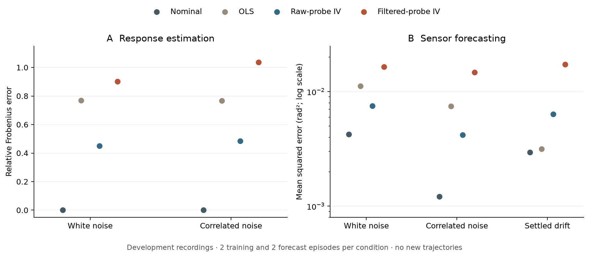

# Controller-filtered instruments: development comparison

Replaying the probe through the nominal collection controller increased both
response-estimation error and sensor-forecast error relative to the raw delayed
probe on these recordings. Both filtered-IV candidates passed the existing
instrument-relevance cutoff. Passing that numerical check did not establish a
useful calibration.

This is an exploratory reanalysis of the
[original development experiment](../identification_component_smoke_v1/README.md),
with no new trajectories. It is not an independent replication or a
calibration-recovery deployment result.



## Comparison

The instrument is the delayed issued command of a noiseless reference integrator
driven only by the original external probes. It uses the nominal response
$B_0=(R_0H_0)^\top$, gain 0.3, leak 0.999, a two-frame delay and the original
command limit. Replay includes the complete burn-in and clipped-command memory.
Actual measurements, realized commands, fault parameters and evaluator response
truth are excluded from instrument construction.

Everything downstream is unchanged: two training episodes per noise condition,
448 retained frames per episode, the 0.05 minimum canonical-correlation cutoff,
episode-wise response estimation with equal averaging, and the two-tap ridge
predictor. The three original baselines are reconstructed before comparison.
See the [methods](../../docs/identification.md#controller-filtered-instruments).

| Added-noise correlation | Nominal response error | OLS | Raw-probe IV | Filtered-probe IV |
| --- | ---: | ---: | ---: | ---: |
| 0 | 0.000001 | 0.768412 | 0.451134 | 0.901557 |
| 0.8 | 0.000001 | 0.767958 | 0.485516 | 1.037051 |

Entries are relative Frobenius errors against the physical response. The
filtered instruments' minimum canonical correlations across training episodes
were 0.06414 and 0.05853, respectively. The nominal calibration is already almost
exact in this matched linear plant.

Forecast MSE per calibrated noisy modal channel, averaged equally across the
two forecast episodes, in rad²:

| Condition and frame window | Nominal | OLS | Raw-probe IV | Filtered-probe IV |
| --- | ---: | ---: | ---: | ---: |
| White added noise, 64–511 | 0.00423008 | 0.01120461 | 0.00749011 | 0.01645528 |
| Correlated added noise, 64–511 | 0.00120997 | 0.00747745 | 0.00418685 | 0.01471829 |
| Correlated noise, before drift, 64–255 | 0.00121310 | 0.00714716 | 0.00417435 | 0.01493333 |
| Correlated noise, settled drift, 288–511 | 0.00295587 | 0.00316437 | 0.00636836 | 0.01728676 |

The fitted predictors stay frozen during drift. These targets contain sensor
noise; forecasting them is not equivalent to reconstructing atmospheric phase.
The original paired probing costs and all baseline outcomes are unchanged.
Two episodes per condition do not support population rankings or uncertainty
intervals. The comparison neither rejects controller-based instruments in
general nor evaluates an optimal IV estimator. It shows that this fixed
reference filter did not improve this development benchmark.

## Reproduce

- Acquisition source: [`78aa5ec`](https://github.com/noetherlabs/noether-ao/commit/78aa5ec34ed1e5dae239569c476d0e68b8db45bc).
- Analysis source: [`5ea9418`](https://github.com/noetherlabs/noether-ao/commit/5ea94185b0720573f1a691c19db5f5580648e8ca).
- [Manifest](manifest.json): analysis source inventory, 37 consumed-file hashes,
  runtime and 11 derived artifacts; raw recordings remain in their original directory.
- [Evidence](evidence.json): both fitted models, every forecast, unchanged baseline
  models and original probing costs.

Use a Git checkout containing both source commits. From the repository root:

```sh
.venv/bin/python results/controller_filtered_iv_v1/verify.py
.venv/bin/python results/controller_filtered_iv_v1/plot.py
```

The NumPy verifier checks the source/input chain and original experiment,
independently replays the reference controller, refits two-stage least squares
and augmented ridge predictors, and reconstructs every new forecast and metric.
It does not import the production identification implementation or acquire data.
