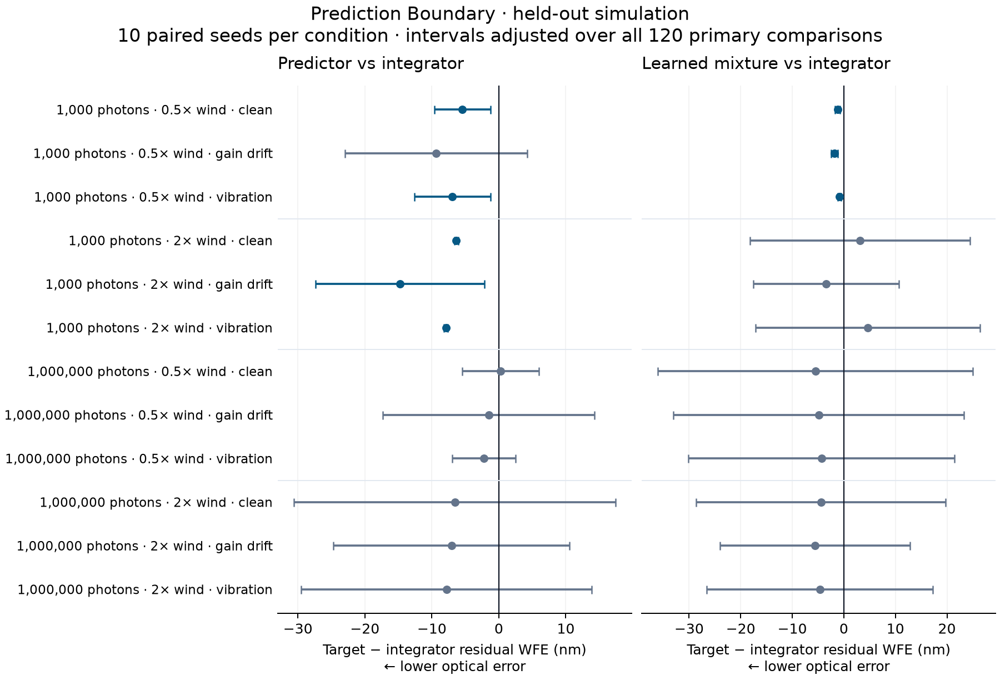

# Prediction Boundary

## Where prediction helps in a delayed pyramid-sensor loop

A causal two-tap predictor reduced residual wavefront error relative to a tuned
integrator in **5 of 12 held-out conditions**. The remaining seven comparisons
were uncertain under the frozen simultaneous intervals. All five supported
advantages occurred at 1,000 photons per frame; none was established at
1,000,000 photons. This is a conditional result in simulation, not a new
predictive-control method or an instrument-performance claim.

The learned mixture beat the integrator in three conditions and the nonlinear
forward controller in five, but **did not beat both in any condition**. The
forward controller beat the learned mixture in two conditions. A more complex
controller therefore did not deliver a consistent advantage in this study.



## Experimental question

When does prediction justify changing the controller of a delayed optical loop?
The study holds the physical plant, atmospheric histories, detector streams,
command delay and evaluation criteria fixed while comparing five controller
families. Its immediate use is to identify conditions worth testing on an
instrument and conditions where additional complexity is not yet justified.
It does not recommend changing a deployed controller.

## Protocol

The [frozen protocol](../../docs/controller_study_v1.md) specifies separate
training, validation and evaluation streams. Thirty candidates—six for each
family—were considered. Training used 12 shared pilot episodes and fitted six
predictors and six learned candidates. Validation used 600 clean trials across
four photon/wind regimes and five seeds. Twenty-seven candidates passed the
predeclared eligibility requirements. Selection chose one candidate per family,
without using the held-out outcomes or refitting afterward.

The final evaluation contains **600 complete trials**: five controllers × four
regimes × three fault conditions × ten paired seeds. Each episode has 512 frames,
with the first 128 excluded from the primary score. Faults act on frames 256–511;
clean runs retain the same analysis windows. Every acquired evaluation trial is
represented. No controller was withheld after selection.

The plant uses a 32×32 pupil, 100 calibrated modes, an unmodulated pyramid sensor,
a 64×64 detector, a 750 nm wavelength and a two-frame command delay. Photon levels
are 1,000 and 1,000,000 per frame; wind multipliers are 0.5 and 2. Detector noise is
Poisson plus Gaussian read noise. Disturbances are clean operation, optical-gain
drift toward 0.35, and a 0.7 rad, 40 Hz vibration. The [base configuration](provenance/base.json)
and [study configuration](provenance/study.json) retain all values.

| Controller | Validation-selected setting |
| --- | --- |
| Integrator | Gain 0.5; leak 0.99 |
| Causal predictive | Two-tap per-mode fit; horizon 1; ridge 0.01 |
| Nonlinear forward | Gain 0.5; leak 0.99; fixed three-step estimator |
| Fixed mixture | Gain 0.5; leak 0.99 |
| Learned mixture | Gain 0.5; leak 0.99; one initialization, 20 Adam steps |

The primary quantity is each run's post-burn residual WFE, computed as the square
root of mean pupil phase variance and converted to nanometres. It is not the mean
of framewise RMS values. Comparisons pair the ten atmospheric/detector seeds.
Student-t intervals use a Bonferroni adjustment across all **120** predeclared
controller-pair/condition contrasts, targeting 95% simultaneous coverage under
the seed-level sampling assumptions. A supported advantage also requires every
trial of the proposed winner to pass the declared usefulness and saturation
criteria. Failure to exclude zero is not equivalence.
Fault-window intervals are exploratory and do not supply another acceptance gate.

## Predictive versus integrator

Positive differences below mean lower WFE for the predictive controller.
The intervals belong to the full 120-comparison family, not a smaller family
chosen from this table.

| Photons/frame | Wind scale | Fault | Integrator − predictive WFE (nm) | Simultaneous interval (nm) | Supported advantage |
| --- | --- | --- | --- | --- | --- |
| 1,000 | 0.5 | none | 5.44 | [1.25, 9.63] | Predictive |
| 1,000 | 0.5 | optical gain | 9.39 | [-4.20, 22.99] | Uncertain |
| 1,000 | 0.5 | vibration | 6.93 | [1.24, 12.62] | Predictive |
| 1,000 | 2 | none | 6.35 | [6.07, 6.63] | Predictive |
| 1,000 | 2 | optical gain | 14.75 | [2.14, 27.35] | Predictive |
| 1,000 | 2 | vibration | 7.88 | [7.58, 8.17] | Predictive |
| 1,000,000 | 0.5 | none | -0.28 | [-5.99, 5.43] | Uncertain |
| 1,000,000 | 0.5 | optical gain | 1.52 | [-14.26, 17.30] | Uncertain |
| 1,000,000 | 0.5 | vibration | 2.24 | [-2.51, 6.99] | Uncertain |
| 1,000,000 | 2 | none | 6.58 | [-17.44, 30.61] | Uncertain |
| 1,000,000 | 2 | optical gain | 7.05 | [-10.57, 24.67] | Uncertain |
| 1,000,000 | 2 | vibration | 7.82 | [-13.88, 29.53] | Uncertain |

For the clean, low-flux, faster-wind condition, mean WFE decreased from 49.10 to
42.75 nm: a 6.35 nm difference, approximately 13% of the integrator mean. The
simultaneous interval is [6.07, 6.63] nm. This is one of the declared conditions,
not a pooled instrument-level effect.

All pairwise comparisons, including unfavorable and uncertain results, are in
[comparisons.csv](comparisons.csv). The [complete report](report.json) retains
per-trial metrics, paired differences, condition summaries, selection and costs.
No post-hoc ranking replaces the frozen comparisons.

Statistical separation is not a minimum useful improvement. Some supported
learned-versus-forward differences are only hundredths of a nanometre. The
protocol declared no instrument-specific threshold for practical value.

## Resource costs

Evaluation recorded 600 synchronized kernel executions totaling 1,112.56 seconds
and 60 lowering/compilation operations totaling 19.12 seconds. The 600 inclusive
trial spans totaled 1,615.34 seconds, including nested operations and persistence.
These overlapping totals must not be added. Interrupted training attempts remain
in the report rather than being treated as zero-cost work. Acquisition ran on an
Apple M5 Pro using the [recorded runtime](provenance/runtime.json).

These measurements describe this study's acquisition workload. A simulated 1 ms
step does not imply a 1 ms executable deadline. The results do not establish
sensor-to-actuator latency, deadline-tail behavior or a real-time control budget.

## Interpretation and limits

The result supports testing prediction in a specific low-flux region of this
model. It also shows why clean WFS residual improvement alone is insufficient
for choosing an operational controller. An instrument-facing comparison needs
calibrated telemetry timing, science-plane image quality, actuator constraints,
missed deadlines and measured operating costs.

The optical grid, atmospheric model and histories are finite. Ten paired seeds
leave substantial uncertainty in several conditions; Student-t coverage relies
on its sampling model. Learned training uses one initialization and a finite
optimization budget, with Gaussian pathwise noise rather than evaluation's
Poisson sampling. The study does not isolate architecture from optimization
quality. A stronger multivariate predictor or LQG comparator is not included.
No fallback, on-sky validation, hardware reliability or general superiority is
established. This completed cohort is now exposed and must not be reused to tune
a subsequent confirmatory study.

## Evidence and reproduction

The acquisition source is `9620ef30999e15e1f7b35b8a1f1f1288b969d885`;
report reconstruction uses `97b710fb85afad7edff706afc0340cf4721db27e`.
The [manifest](manifest.json), [training freeze](training.json),
[selection freeze](selection.json) and [source inventory](provenance/source.json)
bind the retained evidence. The report SHA-256 is
`d0f0ee69bcc19cd5aa0408197343cb2155508237f28692b857a5fa728ddf06be`.

This directory publishes the report and frozen metadata. Full raw sensor,
phase, command and training archives are retained separately and are **not
included in this repository release**. Metadata alone cannot reproduce the raw
verification. With the complete original run, the [execution guide](../../docs/controller_study_execution.md)
describes acquisition and report reconstruction. The additional physical audit
recomputes residual variance, coherent pupil Strehl, zero-DM references, applied
command delay and modal bounds from saved arrays using NumPy without importing
the simulation kernel. It shares the saved basis and atmosphere; it is not an
independent optical-model or hardware validation.

The retained [physical audit](physical-audit.json) passed across all 1,200 trials.
Maximum absolute discrepancies were 7.28×10⁻¹² rad² for controlled variance,
1.20×10⁻¹⁴ for coherent pupil Strehl, and below 5.4×10⁻¹⁵ for the zero-DM
quantities. Checks use 5×10⁻¹² absolute **plus** 5×10⁻¹² relative tolerance;
the variance maximum is compatible with that combined bound. This supplementary
audit was specified after the main report was observed, before its own execution.

```sh
.venv/bin/python scripts/report_controller_study.py \
  --run /path/to/original-run --out /path/to/new-report.json
.venv/bin/python scripts/audit_controller_physical_metrics.py \
  --run /path/to/original-run --report /path/to/new-report.json \
  --out /path/to/new-physical-audit.json
.venv/bin/python scripts/plot_controller_study.py \
  --report results/controller_study_v1/report.json --out /path/to/new-figure.png
```

The [earlier v0 findings](../../docs/results.md) retain their original
configurations and evidence. They are not relabelled as this held-out study.

## Citation

Noether Labs. *Prediction Boundary: Where prediction helps in a delayed
pyramid-sensor loop*. 2026.
https://github.com/noetherlabs/noether-ao/tree/main/results/controller_study_v1
