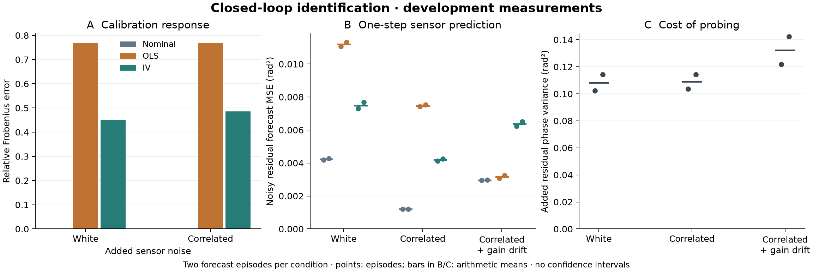

# Closed-loop identification: development measurements

Instrumental-variable estimation reduced response error relative to ordinary
least squares on the same probed recordings. Both fitted calibrations had
higher sensor-forecast error than the nominal calibration. Probing increased
residual wavefront variance in every paired recording.

These are component measurements on development identities. They do not validate
a controller, establish an identification advantage on independent instruments,
or constitute a completed held-out study.



## Experimental conditions

| Quantity | Value |
| --- | --- |
| Acquisition source | [`78aa5ec`](https://github.com/noetherlabs/noether-ao/commit/78aa5ec34ed1e5dae239569c476d0e68b8db45bc) |
| Sensor and plant | Linear modal sensor; 16 × 16 pupil; 4 controlled modes |
| Collection controller | Integrator; gain 0.3; leak 0.999; two-frame command delay |
| Episode length | 512 frames at a simulated 1 ms timestep; first 64 frames excluded from summaries |
| Independent excitation | Gaussian command requests, 0.1 rad standard deviation per mode |
| Added sensor noise | Stationary AR(1), standard deviation 0.05; correlation 0 or 0.8 |
| Calibration episodes | Two per noise condition, with independent atmosphere/detector roots |
| Forecast episodes | Two per condition; paired probed/unprobed recordings |
| Drift | Optical-contrast gain decreases from 1 to 0.6 over 32 frames, beginning at frame 256 |
| Runtime | CPU, float64; NumPy 2.4.6; JAX/JAXlib 0.10.2; dLux 0.15.1 |

The AR(1) perturbation is added to the existing white sensor noise. The full
configuration and exact stream identities are in [manifest.json](manifest.json).
The [methods](../../docs/identification.md) define the observation equation,
instrument assumptions, causal forecast origin and withholding rules.

## Response estimation

Relative Frobenius error of the equally averaged training-episode response
against the physical calibration response:

| Added-noise correlation | Nominal | OLS | IV |
| --- | ---: | ---: | ---: |
| 0 | 0.000001 | 0.768412 | 0.451134 |
| 0.8 | 0.000001 | 0.767958 | 0.485516 |

The nominal response is already almost exact in this matched linear plant.
IV reduces the OLS error but retains substantial finite-sample error. Minimum
canonical correlations across the two training episodes are 0.06195 and 0.06012
for the two noise conditions, respectively, against the configured relevance
cutoff of 0.05. Passing that cutoff does not certify accurate identification.
All six fitted pipelines were retained; the zero-excitation checks withheld IV.

## Sensor prediction and excitation cost

Mean squared error per modal channel, averaged equally over the two forecast
episodes. Targets are calibrated noisy residual observations, in rad². Each
candidate uses only past observations and commands already issued at the
forecast origin.

| Condition and target window | Nominal | OLS | IV |
| --- | ---: | ---: | ---: |
| White added noise, frames 64–511 | 0.00423008 | 0.01120461 | 0.00749011 |
| Correlated added noise, frames 64–511 | 0.00120997 | 0.00747745 | 0.00418685 |
| Correlated noise, before drift, frames 64–255 | 0.00121310 | 0.00714716 | 0.00417435 |
| Correlated noise, settled drift, frames 288–511 | 0.00295587 | 0.00316437 | 0.00636836 |

The fitted models remain frozen during drift. These measurements test transfer,
not adaptation. Improved predictability of correlated observation noise is not
evidence of improved atmospheric reconstruction. OLS approaching the nominal
forecast after drift does not establish a better physical calibration.

| Paired condition | Increase in mean residual spatial phase variance (rad²) |
| --- | ---: |
| White added noise | 0.108233 |
| Correlated added noise | 0.109026 |
| Correlated added noise with drift | 0.132186 |

The requested-probe RMS values were 0.098056 and 0.099724 rad across the two
forecast roots. No probed forecast frame saturated after burn-in. The variance
differences compare the same integrator with and without excitation, with paired
atmosphere and sensor-noise draws. They include the controller's response to
probing; they are not an isolated probe-energy calculation or a comparison of
alternative controllers. Two development episodes do not support uncertainty
intervals or population-level rankings.

## Retained evidence and reconstruction

[evidence.json](evidence.json) retains every episode's metrics, fitted matrices,
predictor coefficients and fit diagnostics. [manifest.json](manifest.json) binds
35 artifacts: 16 raw trajectories, 18 forecast arrays and the evidence record.
The raw trajectories include evaluator-only phase truth; the fitting interface
accepts only observations, applied commands and delayed probe requests.

From the repository root:

```sh
.venv/bin/python results/identification_component_smoke_v1/verify.py
.venv/bin/python results/identification_component_smoke_v1/plot.py
```

This checks source bytes at the acquisition commit, resolves both committed
configurations and checks their hashes against the embedded inputs. It verifies
all artifact hashes,
reconstructs the response estimates with independent two-stage least squares,
refits predictors with augmented ridge least squares, and reproduces forecasts,
losses and probe costs using NumPy. It does not acquire new trajectories.
The second command regenerates the figure with Matplotlib; panel B uses only
the settled window for the drift condition, while panel C includes the complete
post-burn-in trajectory for the corresponding probing cost.

For a new development run, follow the [component-check commands](../../docs/identification.md#component-checks).
No latency measurement, nonlinear pyramid qualification, hardware result or
controller-superiority claim is made by this recording.
