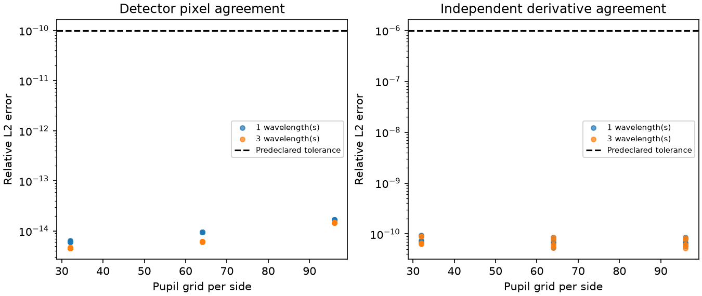

# Independent ideal-pyramid comparison

All predeclared gates passed: **True**. 36 pixel cases, 30 derivative cases, and 24 deliberate error controls.

Maximum intensity relative L2 error: 1.69423354e-14. Maximum derivative relative L2 error: 9.36088503e-11. Maximum absolute power error: 9.76996262e-15. Smallest deliberate error: 0.0312914684.

See [pixel cases](pixels.md), [derivatives](derivatives.md), [negative controls](controls.md), [configuration](config.json), [provenance](provenance.json), and retained arrays in `raw/`.

The independent reference uses HCIPy matrix integrals and a physical thin surface. The production sensor and all M0–M7 baseline data are unchanged. Agreement covers the matched finite-grid ideal contract; it does not establish convergence to an unbounded focal plane, agreement with native HCIPy defaults, on-sky behavior, controller fairness or safe fault recovery.
