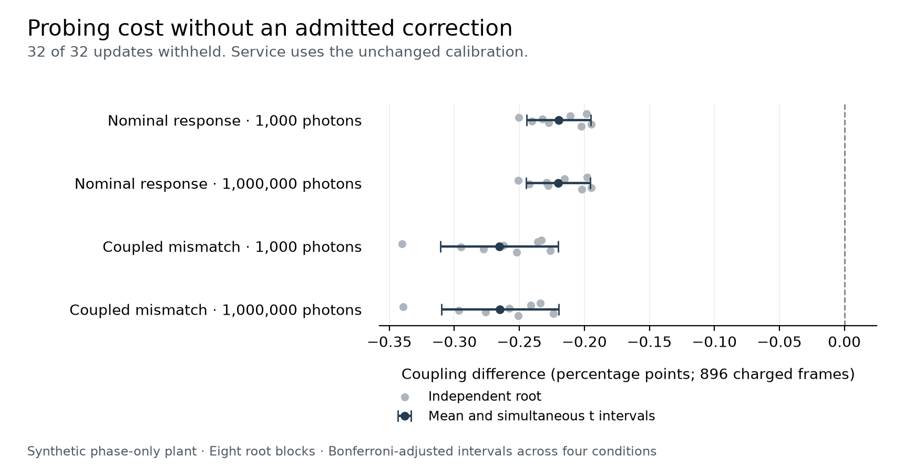

# The cost of withheld calibration

18 November 2026 · Synthetic receiver-calibration development study

An optical system can decline an uncertain calibration after already spending
light on the measurements needed to assess it. We measured that cost in a
16-mode adaptive-optics simulation with an ideal Gaussian receiver.

**None of 32 proposed corrections passed the declared admission checks.**
Seventeen were withheld for weak instruments; fifteen exceeded the
reconstructor-gain budget. Each retained the original service controller.
Probing and washout reduced mean coupling by **0.2424 percentage points** over
the 896 charged frames. The eight-root, model-dependent 95% t interval for
that loss is **0.2182–0.2667 percentage points**.



## Complete comparison

Each of eight independent roots covers all four conditions. Photon counts
refer to the wavefront sensor. Coupling is a fraction of incident pupil power
in an ideal centered Gaussian mode at 1550 nm.

| Sensor response | Photons per frame | Mean coupling change, percentage points | Simultaneous t interval |
| --- | ---: | ---: | ---: |
| Nominal | 1,000 | −0.2196 | [−0.2442, −0.1950] |
| Nominal | 1,000,000 | −0.2200 | [−0.2447, −0.1953] |
| Coupled mismatch | 1,000 | −0.2653 | [−0.3106, −0.2200] |
| Coupled mismatch | 1,000,000 | −0.2648 | [−0.3097, −0.2199] |

The four condition intervals use Bonferroni-adjusted two-sided
α = 0.05/4, with seven degrees of freedom. The primary interval averages
conditions within each root and uses α = 0.05; these are separate interval
families. No frame is treated as an independent replicate.

The primary bounded-mean Hoeffding interval is [−0.9627, 0.9579] in absolute
coupling units. It includes zero and is very wide with eight roots. The
t intervals rely on their small-sample distributional approximation; they do
not provide a distribution-free population guarantee.

## What incurred the cost

The [protocol](../../docs/receiver_calibration_development_v1.md) fixes
128 frames of independent ±0.05 rad probes in each mode. A full 16 × 16
response estimate uses the delayed requested probes as instruments and the
actual applied commands as regressors. It receives commissioning telemetry
and the nominal calibration, without access to true phase or receiver scores.

The fitted decision is frozen before generating a separate 640-frame service
recording. Withholding explicitly reuses the nominal service recording, so
**service gain is exactly zero by policy in this cohort**. The reported loss
comes entirely from probing and washout, spread over 256 charged commissioning
frames plus 640 service frames. All 32 outcomes are finite and retained;
there are no missing cells, retries or favorable-outcome exclusions.

This combination of probe budget and unrestricted response estimator did not
produce an admissible correction. The recorded reasons do not isolate the
cause or establish that a rejected controller would be unstable. A useful
next comparison is a response model with fewer fitted parameters, evaluated
on fresh roots against the same probing cost and fixed controller.

## Evidence and reproduction

- Acquisition source: [`9eee3a6`](https://github.com/noetherlabs/noether-ao/tree/9eee3a6ef31db196d0dcb2099e8cf8003e3aebbf).
- [Frozen physical configuration](../../configs/receiver_calibration_development_v1.json)
  and [public reproduction stream table](seeds.json).
- [All 32 derived records, uncertainty estimates and raw-evidence digests](summary.json).
- [Independent packet reader](../../scripts/audit_receiver_calibration.py).

All 32 raw packets were reconstructed twice, with identical audit digests.
The reader checks the applied-command delay, residual phase, coupling and
signed utility. It shares the qualified Gaussian-overlap model; it does not
independently refit the calibration or validate an instrument. Raw phase and
command packets remain retained locally and are **not included in this
derived-data release**. The public stream table excludes private audit
inventory locations; its file digest differs from the original acquisition
audit.

Reconstruct the figure and its statistics from the published cell grid:

```bash
uv sync --locked --extra receiver
uv run --locked --extra receiver python scripts/plot_receiver_calibration.py \
  --summary results/receiver_calibration_development_v1/summary.json \
  --out /tmp/receiver-calibration-figure
```

The destination must be new. Raw-trial reproduction uses the acquisition
commit and the protocol's single-trial commands, with the public stream
table's own digest recorded in the new run.

## Scope

The sensor mismatch is static and modal. Commissioning and service use
independent atmosphere and detector streams, with service starting from zero
commands. This study establishes neither continuous online recovery nor the
duration for which a calibration remains useful. It does not compare against
optimized modal gains or predictive controllers.

The receiver model excludes scintillation, received-power detector noise,
transmission loss, pointing acquisition and modem behavior. These results
describe normalized simulated coupling, with no measured energy, bit-rate,
hardware-reliability or safety claim.
