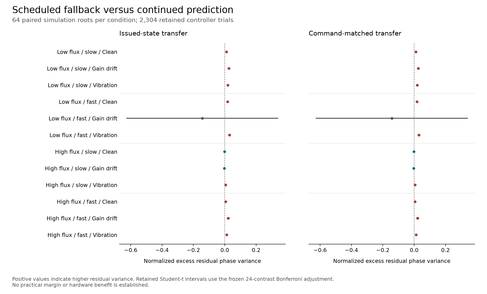
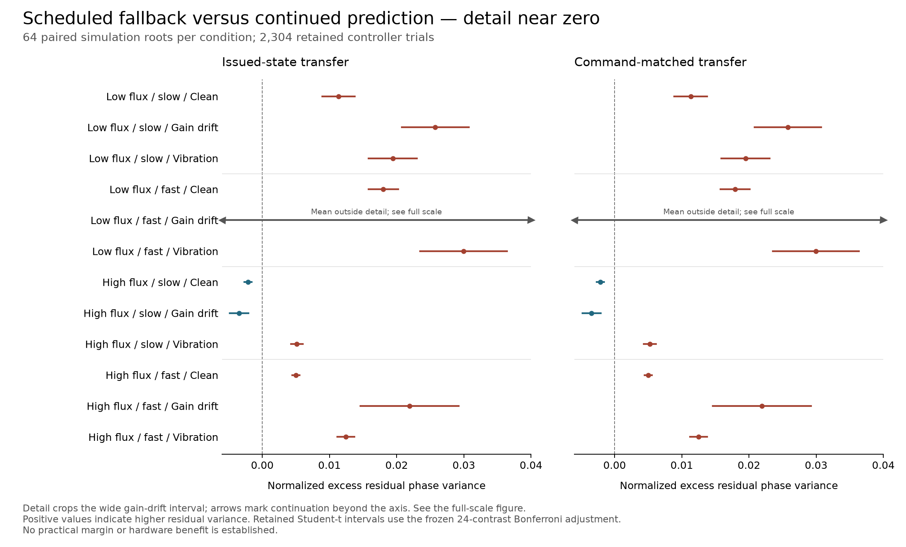

# When recovery hurts

**Scheduled predictive-to-integrator handover in a delayed adaptive-optics loop**

Noether Labs · 18 November 2026

A fallback controller can be familiar, simple and still make the optical error
worse. In this frozen simulation study, switching from prediction to a fixed
leaky integrator increased mean residual error in nine of twelve conditions,
decreased it in two, and left one unresolved. Both tested handover conventions
had this pattern. The comparisons are against continuing prediction; they do
not establish equivalence between the two handovers.

We acquired 64 independent atmosphere roots, crossed with twelve conditions and
three controller arms: 768 cases and 2,304 retained arm records. The primary
analysis contains 1,536 paired records and 24 contrasts. All arms were finite.
The full raw reconstruction passed before any statistical result was inspected.

This is a study of scheduled interventions in simulation. No alarm decides when
to switch, and no hardware reliability claim follows from the result.

## The question

An adaptive-optics loop measures a distorted wavefront and commands a deformable
mirror to correct it. The correction arrives after a delay. A predictor tries
to compensate for that delay; an integrator updates the mirror command using
the measured residual. If conditions change, replacing the predictor with an
integrator may appear conservative. But the replacement changes a running
feedback system, with commands already waiting to reach the mirror.

We ask a narrow question: **given these frozen controllers and a prescribed
switching time, does switching improve the subsequent trajectory?** Clean runs
receive the same intervention and measure the cost of an unnecessary switch.
An instrument's detector, actuator constraints and acceptable loss would need
separate evaluation.

## Experiment

| Quantity | Frozen setting |
| --- | --- |
| Optical plant | Unmodulated pyramid sensor; 32-sample pupil; 100 controlled modes |
| Aperture and wavelength | 1 m; 750 nm |
| Episode | 512 frames at a simulated 1 ms cadence; burn-in ends at frame 128 |
| Intervention | Frame 256; common scoring horizon 256–511 |
| Command delay and clipping | Two frames; ±5 rad per modal command |
| Illumination | 1,000 or 1,000,000 photons |
| Wind multiplier | 0.5 or 2 |
| Conditions | Clean; optical gain ramp to 0.35 over 32 frames; 40 Hz, 0.7 rad vibration |
| Controllers | Frozen `predictive-01`; `integrator-04`, gain 0.5 and leak 0.99 |
| Independent unit | 64 atmosphere roots, reused across conditions and arms |

The controllers and calibration come from the earlier
[Prediction Boundary study](../controller_study_v1/README.md). There is no
recovery-specific fitting. Each case retains a continuing-prediction arm and
two transfers to the integrator. Atmosphere and detector roots are shared;
identical detector keys do not guarantee identical Poisson draws after the
feedback trajectories diverge.

The [resolved example configuration](configuration.json) supplies the atmosphere,
sensor-noise and fault parameters. Wind multipliers apply to the two declared
layer velocities. Each condition injects only its named fault; the clean case
contains no fault injection.

**Issued-state transfer** uses the last issued command as integrator memory and
issues the integrator request at frame 256. **Command-matched transfer** keeps
the outgoing predictor request on that frame and begins the integrator update
at frame 257. Both preserve the command queue. Their first possible physical
effects occur at frames 258 and 259 respectively.

For this one-state integrator, the command-matched construction is exactly an
issued-state transfer one frame later. It is a timing control, not a new
transient compensator. Matching the outgoing request also does not mean zero
command slew: that request can differ from the previous issued command. The
[handover mechanics](../../docs/controller_handover.md) specify clipping, state
and queue semantics.

## What the score means

For root $s$, the primary score is

$$
D_s =
\frac{\sum_{t=256}^{511}\left(\sigma^2_{\mathrm{transfer},s,t}
-\sigma^2_{\mathrm{continue},s,t}\right)}
{\sum_{t=256}^{511}\sigma^2_{\mathrm{zero\ DM},s,t}}.
$$

Here $\sigma^2$ is residual phase variance in radians squared. The denominator
uses the same atmosphere and injected disturbance with no mirror correction.
The common time step cancels. A positive score means that the switch increased
the integrated error; a negative score means that it reduced it. The reported
mean averages the 64 per-root ratios, rather than pooling their denominators.

A score of 0.01 means additional integrated variance equal to 1% of that root's
zero-mirror reference. It does **not** mean 1% worse wavefront RMS, image quality
or error relative to the continuing predictor. No instrument-specific practical
margin was specified.

## Results



The plot retains every primary comparison on one common horizontal scale.
Positive values favor continuing prediction. The wide interval in the
low-flux, fast-wind gain-drift condition dominates that scale;
[all numerical values](all-contrasts.md) and [full-precision root records](report.json)
are provided alongside it.



This detail view uses the same values and intervals. Arrows mark the unresolved
interval extending beyond the axis; its mean is outside this view and remains
visible in the full-scale figure above. No condition is removed.

| Outcome against continuing prediction | Issued state | Command matched |
| --- | ---: | ---: |
| Increased mean residual variance | 9 / 12 | 9 / 12 |
| Decreased mean residual variance | 2 / 12 | 2 / 12 |
| Unresolved | 1 / 12 | 1 / 12 |

The favorable mean contrasts occurred at high flux and slow wind, in the clean
and gain-drift conditions. In the clean condition all 64 roots favored switching.
In gain drift, 53 favored switching and 11 favored continuing. A favorable mean
is therefore not a guarantee for each trajectory. In each of the nine conditions
with increased mean error, all 64 roots favored continuing prediction.

The unresolved condition is particularly instructive. At low flux and fast
wind with gain drift, the issued-state mean was **−0.143014**, with an adjusted
interval **[−0.624548, +0.338519]**. Yet switching worsened the score in **62 of
64 roots**. Two large improvements pulled the mean below zero. Command matching
showed the same sign counts and a similarly wide interval. Those two roots,
`2026111104` and `2026111158`, remain in the analysis. Their mechanism has not
been established by this report.

The frozen analysis uses two-sided Student-t intervals with 63 degrees of
freedom and marginal alpha $0.05/24$. Bonferroni accounts for the 24 declared
contrasts without requiring independence between them. Its family coverage
still depends on each interval's marginal coverage: the Student-t procedure is
exact for independent normal root differences and otherwise approximate.
The strongly uneven contributions in the unresolved condition make that
qualification relevant. We retain the planned analysis, expose every root,
and make no directional claim for that condition.

The four-root planning pilot did not predict this uncertainty. Its conditional
largest interval half-width at 64 roots was approximately 0.0447; the observed
half-width in the unresolved issued-state contrast is approximately 0.482.
The planning target was not a precision guarantee. We did not add roots, remove
extreme outcomes or change the endpoint after seeing the result.

## Evidence and reproduction

The [frozen protocol](../../docs/recovery_study_v1.md) defines the cohort,
failure policy, primary family and descriptive secondary outcomes. Acquisition
used source commit `3be53dfc1f1340d0c120c7bd5d600ea6b80f48f0`.
All 2,304 raw arm records were retained and reconstructed before release.
The audit checked source and artifact hashes, complete identities, command
queues, transfer flags and paired outcomes. Independent NumPy phase accounting
recomputed variance and pupil Strehl from the retained phase, basis and pupil.
The largest absolute residual-variance discrepancy was below $10^{-13}$;
the declared absolute and relative tolerances remained $5\times10^{-12}$.
This checks physical accounting against retained arrays; it does not
independently validate the atmosphere or optical-sensor model.

The repository includes the complete [reconstruction report](report.json),
[24-contrast table](all-contrasts.md), [figure generator](plot.py) and
[release provenance](provenance.json). With the repository environment:

```sh
python results/recovery_study_v1/plot.py \
  --report results/recovery_study_v1/report.json --out runs/recovery-figures
```

The 79.03 GB raw acquisition remains retained locally and is **not distributed
in this release**. Published root values permit independent statistical
reanalysis; reproducing the complete raw audit requires the raw archives.
Hashes alone are not a downloadable reproduction package. The published
[controller dataset](https://huggingface.co/datasets/noetherlabs/prediction-boundary-v1)
contains the earlier controller study, not these recovery trajectories.

## Implications and scope

This result supports testing the intervention itself before making it the
default response to an alarm. Detector quality and intervention benefit are
separate questions. A plausible alarm can trigger an unhelpful controller
change, while a command-continuous transition can still accumulate optical
error after the boundary.

Controller switching and transient mitigation have established prior art,
including [Raynaud et al. (2016)](https://doi.org/10.1117/12.2234266) and
[Raynaud and Kulcsár (2024)](https://doi.org/10.1016/j.ejcon.2024.101116).
[CLOSE](https://arxiv.org/abs/2103.09921) instead adapts modal integrator gains
from temporal telemetry correlations. We did not compare against these
adaptive or transfer-design methods; the present result concerns two fixed
controllers and two explicit transfer conventions.

The scheduled frame is supplied by the experiment, including at known fault
onset. There is no measured detection rate or false-alarm rate. The predictor
continues in shadow after switching, so this implementation also does not
demonstrate recovery from a crashed primary controller. Simulated cadence is
not execution latency, pupil Strehl is not science-camera performance, and a
modal clip is not an instrument's actuator safety envelope. A real bench study
needs measured timing, calibration state and paired physical interventions.

## Citation

Noether Labs. *When recovery hurts: scheduled predictive-to-integrator handover
in a delayed adaptive-optics loop*. 2026.
https://github.com/noetherlabs/noether-ao/tree/main/results/recovery_study_v1
