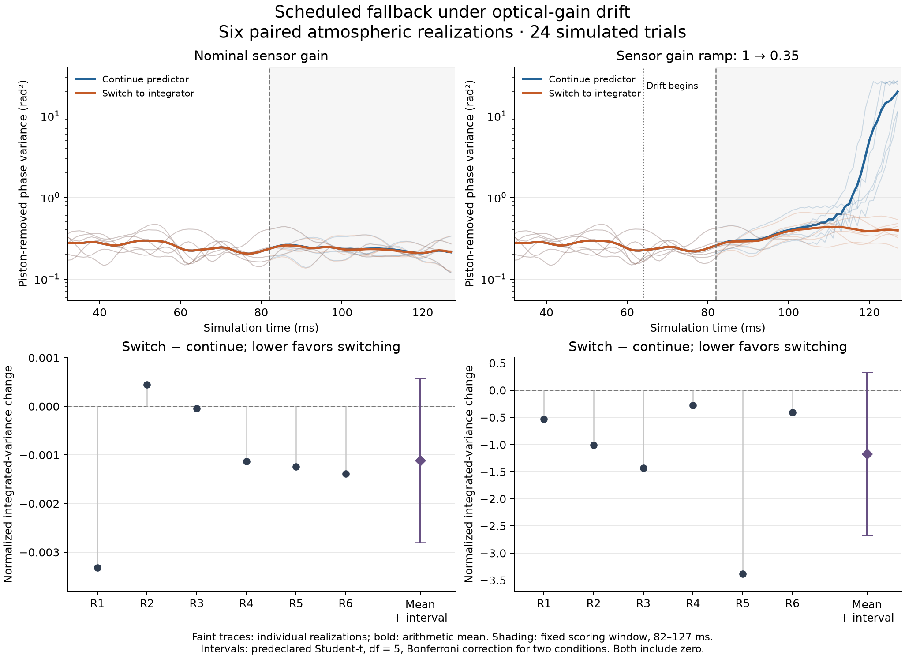

# Scheduled fallback under optical-gain drift

A fixed switch from a temporal predictor to a leaky integrator reduced the
observed integrated residual variance in all six simulated gain-drift cases.
The predeclared uncertainty interval includes zero. Under nominal gain,
switching increased cost in one of six cases. This experiment does not establish
general improvement, equivalence or safe recovery.



## Result

The primary contrast is the switch-minus-continue difference in integrated
phase variance, divided by the **same realization's zero-DM integral**. Negative
values favor switching. These are dimensionless differences, not percentage
improvements over the continuing predictor.

| Sensor condition | Mean paired contrast | Predeclared interval | Higher switch cost |
| --- | ---: | ---: | ---: |
| Nominal | −0.001114 | [−0.002800, 0.000573] | 1 / 6 |
| Gain drift | −1.172503 | [−2.677436, 0.332429] | 0 / 6 |

All 24 trials produced valid traces. Intervals use six independent atmospheric
realizations, five degrees of freedom and a Bonferroni correction for the two
sensor conditions. They are sensitive to the small-sample distributional
assumptions. Frames within a trajectory are not independent replicates.

The figure includes every realization. Faint lines show individual residual
variance traces; bold lines show their arithmetic mean. The lower panels show
all paired contrasts and the mean with its interval. The two contrast panels
use different vertical scales.

## Experiment

Both arms use the same phase realization and exogenous random seeds. One keeps
the selected predictor; the other switches at frame 80 to the selected
integrator, whose first command takes effect at frame 82. Sensor images are
allowed to diverge after the actions diverge. The comparison is scheduled;
there is no fault detector.

- **Plant:** 16 × 16 pupil, eight DM modes, pyramid sensor, 32 × 32 detector,
  750 nm wavelength, 1 ms simulation timestep and two-frame actuator delay.
- **Policies:** predictor P3, ridge 0.01; integrator I4, gain 0.5 and leak 0.999.
  Both were selected on separate data and held fixed for this cohort.
- **Perturbation:** sensor intensity contrast relative to the flat-wavefront
  image ramps from gain 1 to 0.35 over frames 64–96. This is a specified
  sensor-response perturbation, not a simulation of every physical cause of
  optical-gain drift.
- **Outcome window:** frames 82–127 of each 128-frame trajectory. The 32-frame
  burn-in, switch time and scoring window were fixed before acquisition.

The retained traces agree exactly between arms before switching and in their
physical response before the delayed command takes effect. Nominal and drifted
traces agree exactly before drift onset. Complete methods and the normalization
are in [scheduled fallback](../../docs/scheduled_fallback.md).

## Reconstruct the measurements

From the repository root, using the existing Python environment:

```sh
.venv/bin/python results/scheduled_fallback_v1/verify.py
.venv/bin/python results/scheduled_fallback_v1/plot.py
```

The NumPy verifier checks the package inventory, file hashes, array schemas,
physical phase metrics, delayed commands, causal prefixes and all paired
statistics. It reconstructs measurements from retained phase, basis and applied
commands without invoking the optical simulator. Plotting additionally needs
Matplotlib. [assessment.json](assessment.json) retains every trial and both
primary and secondary outcomes.

[manifest.json](manifest.json) distinguishes original acquisition digests from
exported file digests. Numerical archives are unchanged; metadata uses relative
paths. The verifier shares qualified numerical reduction functions with the
acquisition analysis and independently computes the Student-t quantile. This
package supports retained-array reconstruction. It does not yet reproduce the
complete acquisition, historical policy fitting or selection from a fresh clone.

## Scope

The cohort contains six short synthetic realizations of one plant, one sensor
perturbation and one selected policy pair. No telescope data, hardware timing,
long-horizon stability or detector performance is measured. The predictor
continues running after handover; a failed primary implementation is not tested.
A lower integrated
cost does not guarantee reacquisition or safe authority transfer. The optional
reference-return statistic records the first eight-frame visit below a fixed
baseline threshold; it does not require remaining there afterward.

When citing this result, identify the retained cohort and repository revision:

```bibtex
@misc{noether2026scheduledfallback,
  title = {Scheduled Fallback under Optical-Gain Drift},
  author = {{Noether Labs}},
  year = {2026},
  url = {https://github.com/noetherlabs/noether-ao/tree/main/results/scheduled_fallback_v1}
}
```
