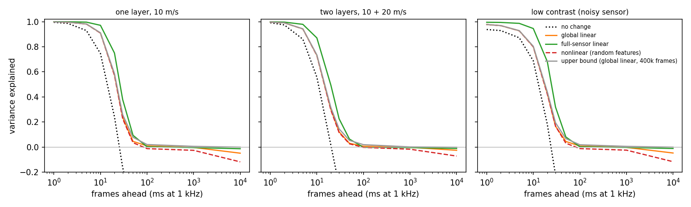
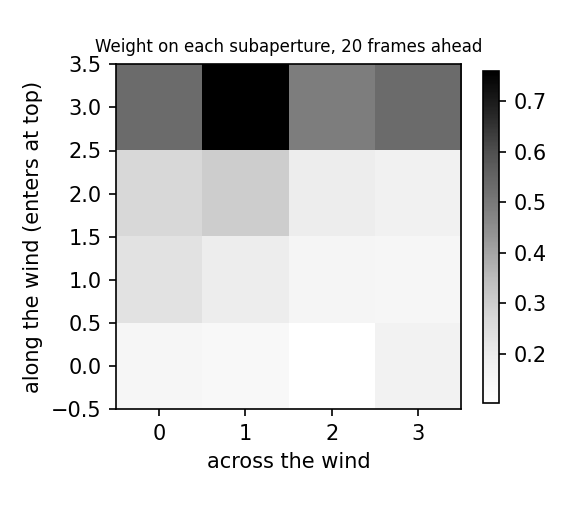

# Shift prediction and range forecasting: results (protocol v1)

Simulation only. Five evaluation seeds per regime; mean ± sample standard deviation. Skill is the fraction of target variance explained (1 is perfect, 0 is the mean). Methods and the frozen protocol: [docs/shift_prediction.md](../../docs/shift_prediction.md).

## one layer, 10 m/s

| Frames ahead | no change | global linear | full-sensor linear | nonlinear (random features) | upper bound (global linear, 400k frames) |
| --- | --- | --- | --- | --- | --- |
| 1 | +0.995 ± 0.000 | +0.998 ± 0.000 | +1.000 ± 0.000 | +0.998 ± 0.000 | +0.998 ± 0.000 |
| 2 | +0.986 ± 0.001 | +0.996 ± 0.000 | +0.999 ± 0.000 | +0.996 ± 0.000 | +0.996 ± 0.000 |
| 5 | +0.929 ± 0.005 | +0.981 ± 0.001 | +0.996 ± 0.000 | +0.981 ± 0.001 | +0.982 ± 0.001 |
| 10 | +0.746 ± 0.019 | +0.910 ± 0.006 | +0.971 ± 0.002 | +0.909 ± 0.006 | +0.911 ± 0.006 |
| 20 | +0.241 ± 0.053 | +0.577 ± 0.027 | +0.750 ± 0.019 | +0.572 ± 0.027 | +0.586 ± 0.027 |
| 30 | -0.162 ± 0.070 | +0.238 ± 0.041 | +0.379 ± 0.040 | +0.227 ± 0.037 | +0.259 ± 0.041 |
| 50 | -0.505 ± 0.077 | +0.046 ± 0.042 | +0.094 ± 0.033 | +0.036 ± 0.038 | +0.079 ± 0.033 |
| 100 | -0.801 ± 0.130 | +0.010 ± 0.029 | +0.004 ± 0.025 | -0.012 ± 0.035 | +0.021 ± 0.031 |
| 1000 | -1.092 ± 0.119 | -0.002 ± 0.013 | -0.003 ± 0.013 | -0.025 ± 0.019 | +0.006 ± 0.004 |
| 10000 | -1.078 ± 0.167 | -0.048 ± 0.024 | -0.012 ± 0.023 | -0.117 ± 0.071 | -0.000 ± 0.003 |

Paired differences against global linear (95% t-interval over seeds):

- full-sensor linear, 10 frames: +0.061 [+0.056, +0.066]
- nonlinear (random features), 10 frames: -0.001 [-0.002, -0.001]
- full-sensor linear, 20 frames: +0.173 [+0.162, +0.184]
- nonlinear (random features), 20 frames: -0.005 [-0.007, -0.003]
- Upper bound minus finite-data global linear, 10 frames: +0.001

Range forecast for the next 10,000 frames, drifting seeing (target coverage 95.4%):

| Band | Coverage | Half-width (arcsec) |
| --- | --- | --- |
| naive | 91.5% ± 3.7 | 1.28 ± 0.15 |
| twin | 93.4% ± 3.1 | 1.38 ± 0.17 |
| conformal | 93.0% ± 5.9 | 1.47 ± 0.37 |

Wind read from subaperture delays: 10.0, 10.0, 10.0, 10.0, 10.0 m/s (true layer speeds: 10 m/s).

## two layers, 10 + 20 m/s

| Frames ahead | no change | global linear | full-sensor linear | nonlinear (random features) | upper bound (global linear, 400k frames) |
| --- | --- | --- | --- | --- | --- |
| 1 | +0.992 ± 0.001 | +0.996 ± 0.000 | +0.998 ± 0.000 | +0.996 ± 0.000 | +0.996 ± 0.000 |
| 2 | +0.974 ± 0.002 | +0.991 ± 0.001 | +0.997 ± 0.000 | +0.991 ± 0.001 | +0.991 ± 0.001 |
| 5 | +0.860 ± 0.010 | +0.943 ± 0.004 | +0.979 ± 0.002 | +0.942 ± 0.004 | +0.943 ± 0.004 |
| 10 | +0.558 ± 0.030 | +0.732 ± 0.018 | +0.871 ± 0.010 | +0.730 ± 0.017 | +0.735 ± 0.018 |
| 20 | +0.015 ± 0.054 | +0.301 ± 0.030 | +0.494 ± 0.028 | +0.295 ± 0.031 | +0.315 ± 0.032 |
| 30 | -0.306 ± 0.055 | +0.122 ± 0.027 | +0.226 ± 0.030 | +0.116 ± 0.028 | +0.146 ± 0.027 |
| 50 | -0.596 ± 0.067 | +0.031 ± 0.028 | +0.065 ± 0.022 | +0.027 ± 0.025 | +0.054 ± 0.026 |
| 100 | -0.837 ± 0.128 | +0.007 ± 0.018 | -0.002 ± 0.015 | -0.002 ± 0.020 | +0.020 ± 0.023 |
| 1000 | -1.094 ± 0.087 | -0.001 ± 0.010 | -0.003 ± 0.006 | -0.016 ± 0.013 | +0.002 ± 0.004 |
| 10000 | -1.011 ± 0.089 | -0.025 ± 0.008 | -0.010 ± 0.014 | -0.071 ± 0.035 | -0.001 ± 0.005 |

Paired differences against global linear (95% t-interval over seeds):

- full-sensor linear, 10 frames: +0.138 [+0.127, +0.149]
- nonlinear (random features), 10 frames: -0.002 [-0.003, -0.001]
- full-sensor linear, 20 frames: +0.192 [+0.178, +0.207]
- nonlinear (random features), 20 frames: -0.006 [-0.011, -0.001]
- Upper bound minus finite-data global linear, 10 frames: +0.003

Range forecast for the next 10,000 frames, drifting seeing (target coverage 95.4%):

| Band | Coverage | Half-width (arcsec) |
| --- | --- | --- |
| naive | 91.3% ± 2.8 | 1.30 ± 0.12 |
| twin | 93.1% ± 2.3 | 1.38 ± 0.13 |
| conformal | 93.7% ± 4.8 | 1.49 ± 0.22 |

Wind read from subaperture delays: 10.4, 10.4, 19.3, 10.4, 10.4 m/s (true layer speeds: 10, 20 m/s).

## low contrast (noisy sensor)

| Frames ahead | no change | global linear | full-sensor linear | nonlinear (random features) | upper bound (global linear, 400k frames) |
| --- | --- | --- | --- | --- | --- |
| 1 | +0.938 ± 0.004 | +0.977 ± 0.001 | +0.995 ± 0.000 | +0.977 ± 0.001 | +0.977 ± 0.001 |
| 2 | +0.929 ± 0.005 | +0.969 ± 0.002 | +0.994 ± 0.001 | +0.969 ± 0.002 | +0.969 ± 0.002 |
| 5 | +0.872 ± 0.009 | +0.928 ± 0.005 | +0.987 ± 0.001 | +0.927 ± 0.005 | +0.929 ± 0.005 |
| 10 | +0.688 ± 0.023 | +0.801 ± 0.013 | +0.946 ± 0.005 | +0.799 ± 0.013 | +0.804 ± 0.014 |
| 20 | +0.183 ± 0.056 | +0.429 ± 0.035 | +0.682 ± 0.023 | +0.423 ± 0.035 | +0.441 ± 0.036 |
| 30 | -0.221 ± 0.072 | +0.167 ± 0.032 | +0.320 ± 0.039 | +0.168 ± 0.041 | +0.195 ± 0.041 |
| 50 | -0.563 ± 0.078 | +0.045 ± 0.038 | +0.081 ± 0.031 | +0.031 ± 0.041 | +0.068 ± 0.033 |
| 100 | -0.858 ± 0.130 | +0.009 ± 0.029 | +0.004 ± 0.021 | -0.011 ± 0.034 | +0.019 ± 0.030 |
| 1000 | -1.151 ± 0.120 | -0.002 ± 0.012 | -0.002 ± 0.012 | -0.024 ± 0.018 | +0.006 ± 0.004 |
| 10000 | -1.135 ± 0.166 | -0.047 ± 0.023 | -0.010 ± 0.022 | -0.116 ± 0.065 | +0.000 ± 0.003 |

Paired differences against global linear (95% t-interval over seeds):

- full-sensor linear, 10 frames: +0.144 [+0.134, +0.155]
- nonlinear (random features), 10 frames: -0.002 [-0.004, -0.000]
- full-sensor linear, 20 frames: +0.253 [+0.238, +0.268]
- nonlinear (random features), 20 frames: -0.006 [-0.013, +0.002]
- Upper bound minus finite-data global linear, 10 frames: +0.003

Range forecast for the next 10,000 frames, drifting seeing (target coverage 95.4%):

| Band | Coverage | Half-width (arcsec) |
| --- | --- | --- |
| naive | 92.3% ± 3.3 | 1.31 ± 0.15 |
| twin | 93.5% ± 3.0 | 1.38 ± 0.16 |
| conformal | 92.9% ± 5.7 | 1.44 ± 0.34 |

Wind read from subaperture delays: 10.0, 10.0, 10.0, 10.0, 10.0 m/s (true layer speeds: 10 m/s).

## Honesty checks

- Shuffled targets, one layer, 10 m/s: skill -0.003 (limit 0.02): pass
- Shuffled targets, two layers, 10 + 20 m/s: skill -0.002 (limit 0.02): pass
- Shuffled targets, low contrast (noisy sensor): skill -0.002 (limit 0.02): pass
- Leakage guard asserted at every horizon: pass

## Pre-registered claims

- E1, no frame-by-frame skill at 1,000 frames: supported (best mean skill -0.001)
- E2, the nonlinear challenger does not beat linear: supported
- E3, full sensor beats global only at 10 and 20 frames: supported (overstated in v1; see the post-hoc check)
- E4, conformal coverage within 1 point of 95.4%: not supported (93.0%, 93.7%, 92.9%)

## Post-hoc check, not pre-registered: shared sensor noise

In v1 the global tilt and the subapertures carry independent noise, so the full-sensor model sees the global tilt twice. Here the global tilt is the mean of the measured subapertures and the full-sensor model uses subapertures only. These are the effect sizes to quote.

| Regime | Gain at 1 frames | Gain at 5 frames | Gain at 10 frames | Gain at 20 frames | Gain at 30 frames |
| --- | --- | --- | --- | --- | --- |
| one layer, 10 m/s | +0.023 [+0.020, +0.025] | +0.031 [+0.028, +0.034] | +0.052 [+0.047, +0.056] | +0.098 [+0.091, +0.105] | +0.081 [+0.071, +0.092] |
| two layers, 10 + 20 m/s | +0.036 [+0.033, +0.038] | +0.059 [+0.056, +0.062] | +0.116 [+0.110, +0.122] | +0.139 [+0.128, +0.151] | +0.071 [+0.061, +0.082] |
| low contrast (noisy sensor) | +0.039 [+0.035, +0.043] | +0.059 [+0.053, +0.064] | +0.096 [+0.088, +0.104] | +0.140 [+0.130, +0.150] | +0.086 [+0.067, +0.104] |

The gain already present one frame ahead is better estimation of the current tilt; its growth towards 20 frames is prediction from the upwind subapertures.

## Limitations

- Frozen flow with at most two layers; no vibration, tracking drift, thermal effects or correlation-tracker nonlinearity.
- The square 4 x 4 grid samples phase slightly outside the circular pupil in its corners.
- No range band met 95.4% coverage under drifting seeing. Calibration on past windows did not transfer and gave the widest, least stable bands.
- None of this is a statement about an instrument until it is repeated on recorded frames.

Environment: Python 3.9.7, NumPy 1.22.3, Matplotlib 3.5.1. File digests are in [manifest.json](manifest.json).
