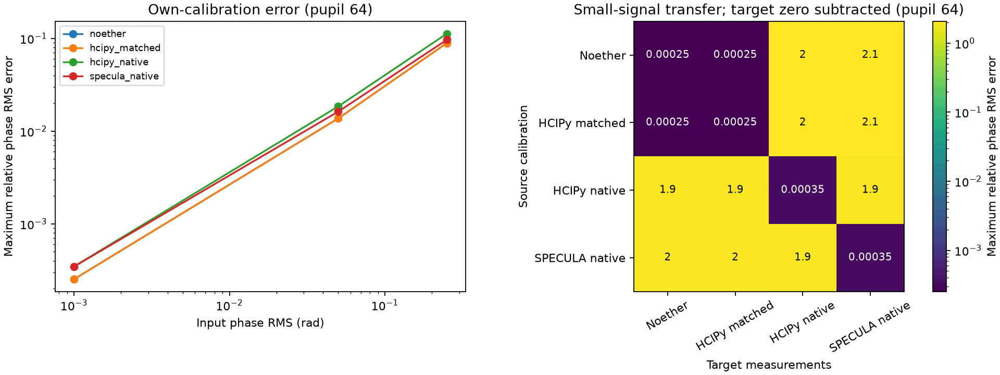

# Independent wavefront-sensor calibration

The matched HCIPy calibration transfers successfully to Noether's ideal pyramid.
Native HCIPy and SPECULA each calibrate accurately, but their unconverted
calibrations are not interchangeable with Noether or with one another.

The frozen run covers four optical paths on 32- and 64-pixel pupils, five modes,
48 held-out mixed wavefronts per path/grid, and 512 noise realizations per
calibration. All eight local calibrations and the matched-reference gates passed.

| Finding | Retained result |
| --- | --- |
| Noether vs matched HCIPy response matrix | Maximum relative L2 difference **5.99e-9** |
| Matched HCIPy/Noether calibration transfer at 0.001 rad RMS | Maximum relative phase RMS error **0.0254%** (rounded upward) |
| Own-calibration reconstruction at 0.001 rad RMS, all four paths | Maximum relative phase RMS error **0.0349%** (rounded upward) |
| Noether calibration applied directly to native SPECULA | Maximum small-signal error **207.2%**, even after subtracting SPECULA's own zero image |
| Own-calibration reconstruction at 0.25 rad RMS | Worst-case relative errors span **8.91–11.38%** across paths/grids |
| Sampled / analytic modal noise variances | **0.877–1.167**, with 512 samples per calibration; diagnostic, not an instrument-noise measurement |

The native models preserve their focal stop, focal centering, pupil ordering and
return-propagation conventions. The comparisons apply no fitted flip, sign,
shift, gain or output-power normalization. Their disagreement is **not a defect
claim against HCIPy or SPECULA**. Small-signal self-calibration is also not evidence
that a native model is physically equivalent to the matched Noether model.

The next comparison needs a source-derived coordinate/phase convention mapping,
then a separately frozen cohort. In particular, zero images must be treated
separately from interaction matrices. Large-phase errors also show why a linear
calibration cannot be assumed accurate over the whole tested amplitude range.

The three optical smoke paths in the normal test environment passed; the separate
SPECULA CPU smoke and the complete retained acquisition also passed. The local
core suite passed **568 tests** before integrating concurrent identification work;
**76 affected tests** passed after that integration. This comparison does not
claim modulation agreement, hardware validity, closed-loop performance or speed.

- [Frozen method and reproduction commands](../../docs/wfs_calibration.md)
- [Full tables](report.md) and [per-case numerical results](summary.json)
- [Configuration](config.json), [source provenance](provenance.json), [artifact hashes](manifest.json)
- [Rebuild verification](verification.json); raw images, probes, matrices and noise samples are in `raw/`
